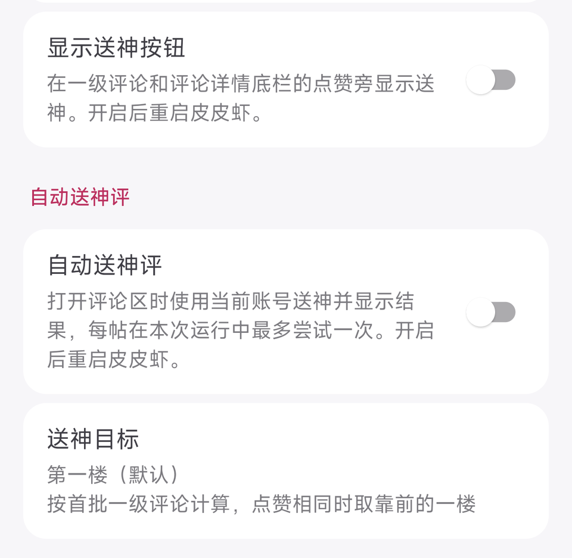
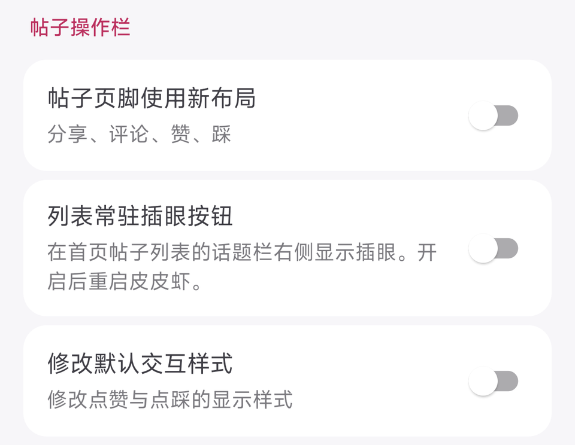
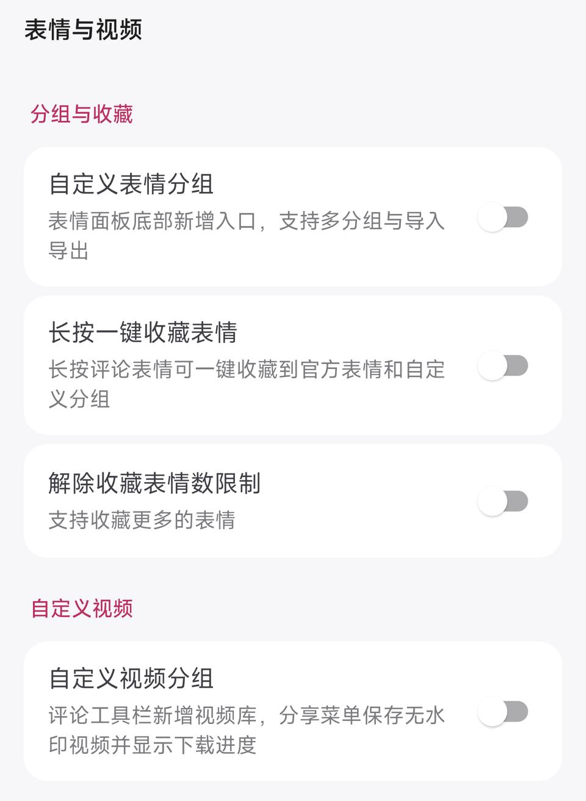
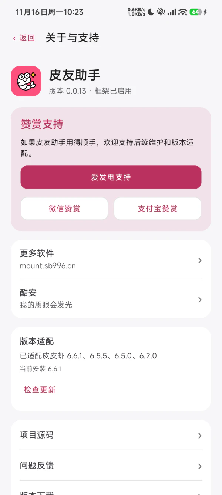

# 皮友助手

皮友助手是基于 LSPosed 的皮皮虾增强模块。可以从皮皮虾「我的」页进入助手，按功能分类浏览或直接搜索设置。

[下载 APK](https://github.com/vs2pk0/ppx-assistant/releases) · [LSPosed 模块仓库](https://github.com/Xposed-Modules-Repo/io.github.vs2pk0.piyou/releases) · [更多软件](https://mount.sb996.cn/)

## 最近更新

- 「列表常驻插眼按钮」支持他人主页的「全部」「帖子」「插眼」。
- 「隐藏帖子和评论的昵称徽章」也能隐藏他人主页头像下方的徽章。
- 「隐藏金币悬浮球」可以隐藏推荐页右侧的 ×2 阅读红包。

## 主要功能

- **首页与评论**　调整频道和底栏，屏蔽广告，按关键词或用户过滤帖子和评论。
- **送神与插眼**　在评论区显示星标送神按钮，已送神时以粉色标记。支持自动给首楼、首批评论中点赞最多的一楼或指定楼层送神，也可在首页和他人主页的帖子里常驻插眼按钮。
- **媒体与播放**　保存图片、去水印视频和音频，调整视频播放倍速。分享时可将文字、图片或视频带到发帖编辑页。
- **表情与视频收藏**　分组管理和预览自定义表情、视频，一次导入全部官方收藏表情。保存自定义视频时会显示进度。
- **备份与恢复**　用 ZIP 导出和恢复模块设置、表情原图、视频及封面。

## 界面截图

  
  

  
  

## 安装与使用

安装 APK 后，在 LSPosed 中启用「皮友助手」并勾选「皮皮虾」作用域。修改开关后，强行停止并重新打开皮皮虾使设置生效。

适配皮皮虾 6.2.0、6.5.0、6.5.5 和 6.6.1。支持 LSPosed 1.9.x 旧版入口及支持 libxposed API 102 的现代框架。

## 赞赏支持

如果皮友助手用得顺手，欢迎支持后续维护和版本适配。[在爱发电支持 Mount](https://afdian.com/a/mount-sb996)

  
  

本项目基于 [Secack/ppx](https://github.com/Secack/ppx) 继续维护，采用 [GPL-3.0](LICENSE) 许可证。[问题反馈](https://github.com/vs2pk0/ppx-assistant/issues)
